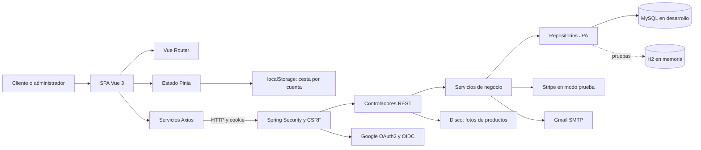
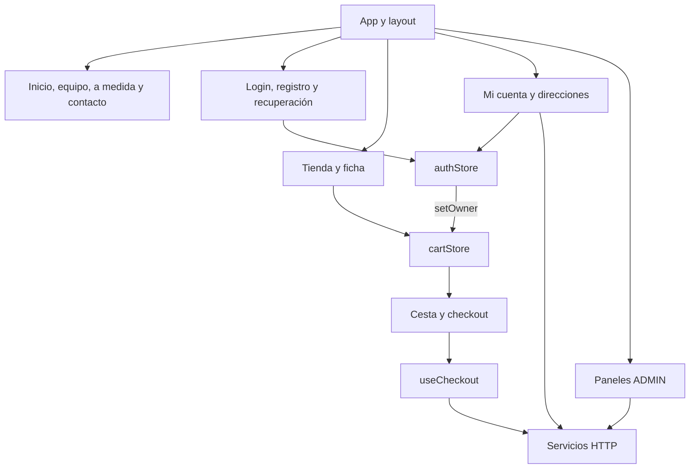
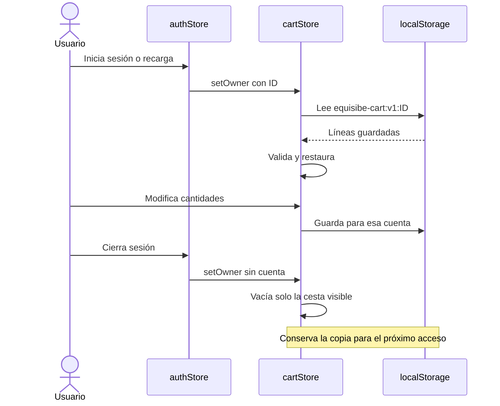
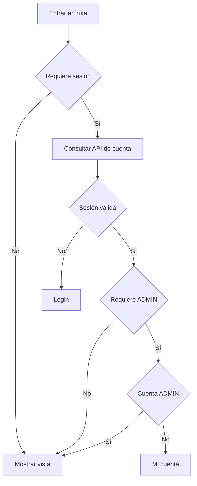

# Diagramas del frontend

## Arquitectura general

El backend es una aplicación organizada por capas, no microservicios. El frontend es una SPA con componentes, vistas, servicios y stores. El servidor aplica permisos y reglas de negocio aunque el navegador ya compruebe el acceso.

## Pantallas y estado

## Cesta por cuenta

## Rutas protegidas

La autorización de la API se aplica independientemente de estas comprobaciones del navegador.
